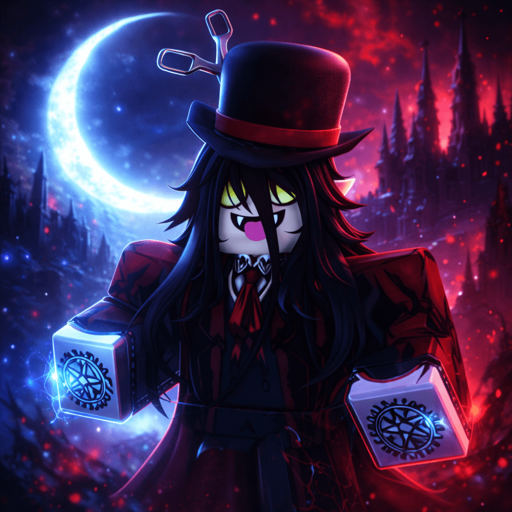
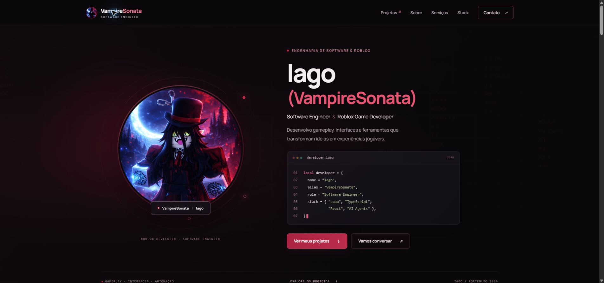

<div align="center">



# Iago · VampireSonata

**Software Engineer & Roblox Game Developer**

Gameplay, interfaces e ferramentas — apresentados em 21 demonstrações em vídeo.

[**Explorar o portfólio ↗**](https://iag0d.github.io/vampiresonata-portfolio/) · [GitHub](https://github.com/IaG0D) · Discord: **iag0d**

[](https://github.com/IaG0D/vampiresonata-portfolio/actions/workflows/deploy.yml)


[](https://iag0d.github.io/vampiresonata-portfolio/)

</div>

## Trabalho em movimento

Portfólio pessoal com identidade em preto e vinho, avatar interativo e projetos apresentados pelo que fazem. Os vídeos mostram sistemas de gameplay, progressão, interfaces, montarias, summons e efeitos desenvolvidos para Roblox.

| Área | Demonstrações | Alguns projetos |
| --- | ---: | --- |
| Eventos & progressão | 1 | Almas Perdidas |
| Gameplay | 4 | Pesca, Guitar Hero, DJ & pista de dança |
| Montarias & summons | 5 | Skeleton Dragon, Hellfire Bike, Shinigami |
| Itens & VFX | 4 | Pedra da Ressurgência, Coração de Morcegos |
| Interfaces | 7 | Tutorial, pintura, catálogo de avatar, loja |

## A experiência

- Galeria com filtros e players com navegação entre projetos.
- Prévias curtas e silenciosas; vídeos completos carregam ao abrir o projeto.
- No máximo uma prévia em reprodução, com pausa fora da tela.
- Layout responsivo, navegação por teclado e suporte a movimento reduzido.
- Fontes locais, capas WebP e animações em CSS, sem bibliotecas de animação.
- Player do YouTube para pesca carregado apenas ao abrir a demonstração.

Construído com **HTML, CSS e JavaScript**, usando **Vite** para desenvolvimento e build. Sem dependências de execução.

## Rodar localmente

Requer Node.js 22.12+ e npm.

```sh
git clone https://github.com/IaG0D/vampiresonata-portfolio.git
cd vampiresonata-portfolio
npm ci
npm run dev
```

Abra **http://localhost:4322**.

```sh
npm run check   # Confere projetos, categorias e arquivos de mídia
npm run build   # Gera o site estático em dist/
npm run preview
```

## Organização

```text
index.html              Estrutura, perfil, serviços e contato
src/
  projects.js           Conteúdo e categorias dos projetos
  main.js               Galeria, players e interações
  style.css             Identidade visual e responsividade
  durations.json        Durações dos vídeos
  technologies.json     Tecnologias apresentadas
public/
  media/                Vídeos, prévias e capas
  fonts/                Fontes locais e suas licenças
  icons/                Ícones das tecnologias
scripts/check.mjs       Validação do conteúdo
.github/workflows/      Publicação automática
```

Para atualizar um projeto, edite `src/projects.js` e os arquivos correspondentes em `public/media/`. Capas usam `<id>.webp`, vídeos completos `<id>.mp4` e prévias `<id>-preview.mp4`. Atualize também `src/durations.json` ao trocar um vídeo.

## Publicação

O workflow verifica o conteúdo, gera o build com o caminho `/vampiresonata-portfolio/` e publica no **GitHub Pages** a cada push em `main`. Também pode ser executado manualmente em **Actions → Publish portfolio**.

Para reproduzir o build publicado:

```sh
npm run build -- --base=/vampiresonata-portfolio/
npm run preview -- --base=/vampiresonata-portfolio/
```

## Contato e créditos

Projetos e contato profissional: [portfólio](https://iag0d.github.io/vampiresonata-portfolio/) · Discord **iag0d**.

Este repositório apresenta o portfólio pessoal de Iago / VampireSonata. Vídeos, identidade e materiais visuais não são disponibilizados sob uma licença de reutilização. Fontes e marcas de terceiros mantêm suas respectivas licenças e direitos.
